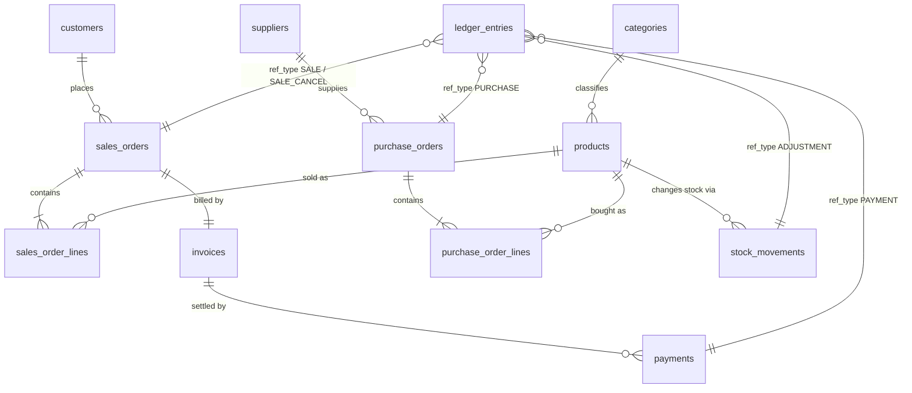

# System Architecture and Database Schema

## 1. Organization and scope
A general goods wholesaler in Kampala buying groceries, beverages, household and stationery items from suppliers and
selling in bulk to retailers, partly on credit. Currency: Uganda Shillings (UGX), stored as integers.

## 2. Architecture
```
 CLI menus (Main)
      |
 Service layer  ->  Master | Sales | Inventory | Finance | Admin      (business rules, transactions)
      |
 Db (JDBC helpers, tx(), post())
      |
 MySQL / MariaDB database `wholesale_erp` (InnoDB: tables, CHECK/UNIQUE/FK constraints, triggers, views)
```
- Three layers: interface, services (business logic), database (integrity rules).
- Rules are enforced twice on purpose: Java gives clear messages, the database is the last line of defence
  (the self-test bypasses Java to prove this).

## 3. Entity-relationship diagram

`ledger_entries` links to its source document through `ref_type` + `ref_id` (a polymorphic reference), so Finance
can trace every posting back to Sales or Inventory.

## 4. Data flow between modules

**New sales order** (one transaction):
1. Sales: insert `sales_orders` and `sales_order_lines` (price and cost frozen on the line).
2. Inventory: insert `stock_movements` (type SALE, negative). A trigger lowers `products.stock_qty`.
3. Finance: insert `invoices`; post Dr Accounts Receivable / Cr Sales Revenue, and Dr COGS / Cr Inventory.
4. Optional upfront payment: `payments` + Dr Cash / Cr Accounts Receivable.
5. Credit-limit check on the customer's outstanding balance. Any failure rolls back steps 1 to 4.

**Goods received:** `purchase_orders` + lines, `stock_movements` (+), weighted-average cost update, Dr Inventory / Cr Accounts Payable.

**Payment:** `payments` row, Dr Cash / Cr Accounts Receivable. A trigger blocks over-payment.

**Cancel order:** reverse stock movements (+), reversing ledger rows, order status CANCELLED. Blocked if payments exist.

**Stock adjustment:** `stock_movements` (ADJUSTMENT) + Dr/Cr Inventory vs Inventory Adjustment at current cost.

## 5. Single source of truth: how it is enforced
| Fact | Stored once in | Everything else |
|---|---|---|
| Stock on hand | `stock_movements` | `products.stock_qty` is updated only by trigger `trg_stock_apply`; the app never writes it |
| Customer balance | `invoices` + `payments` | view `v_customer_balance` (derived, never stored) |
| Invoice status / balance due | `invoices` + `payments` | view `v_invoice_balance` |
| Customer, product, supplier details | one row each | referenced by ID everywhere (no copied names) |
| Money movements | `ledger_entries` (append-only) | trial balance and P&L are queries |

## 6. Constraints and validation
| Type | Examples |
|---|---|
| PRIMARY KEY / AUTO_INCREMENT | every table |
| FOREIGN KEY (`ON DELETE RESTRICT`, enforced by InnoDB) | order > customer, line > product, invoice > order, payment > invoice |
| UNIQUE | `products.sku` (case-insensitive), `customers.phone`, `suppliers.phone`, `categories.name`, one invoice per order, one line per product per order |
| CHECK | `stock_qty >= 0`, `quantity > 0`, prices and costs `>= 0`, `payments.amount > 0`, status and method lists, ledger row is debit XOR credit |
| NOT NULL / DEFAULT | mandatory business fields |
| TRIGGERS | stock apply; stock movements and ledger append-only; payment cannot exceed balance due |
| Application rules | stock available, active customer/product, credit limit, no cancel after payment, editable-field whitelist |
| Integrity audit | `Admin.integrityCheck`: stock = sum of movements, ledger balanced, invoice = lines, receivables = open balances, revenue = invoices |

**MySQL/MariaDB specifics:** all tables use the InnoDB engine (needed for transactions and foreign keys); money is `BIGINT` in UGX;
dates are `DATETIME`; text columns use `utf8mb4` with a case-insensitive collation, which is what makes SKUs unique regardless of
capital letters. Triggers signal their own rejections with `SIGNAL SQLSTATE '45000'`, and the Java code recognises each rule by its
MySQL error code (1062 duplicate, 1451/1452 foreign key, 4025/3819 CHECK, 1644 trigger rule), not by message text.
The program runs the script in `sql/schema.sql` at start-up; the script is safe to run repeatedly.

## 7. Known limits (prototype scope)
- Single user and a single database connection, command-line interface. MySQL/MariaDB itself would support many concurrent users, but the program does not yet (no connection pool, no login or roles).
- No user login or roles, no tax (VAT), no multi-currency, no supplier payments (accounts payable is never settled), no partial cancellations or returns.
- Documented as scope boundaries, not hidden: these are the features a production system would add.
